<p align="center">
  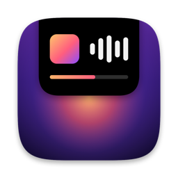
</p>

<h1 align="center">NotchBox</h1>

<p align="center">
  MacBook'unun çentiğini müzik çalara, panoya, takvime ve giriş kodlarına çevirir.<br>
  <sub>Turns your MacBook's notch into a music player, clipboard, calendar and sign-in code box. <a href="#english">Read in English</a></sub>
</p>

<p align="center">
  
  
  
  <a href="LICENSE"></a>
</p>

<p align="center">
  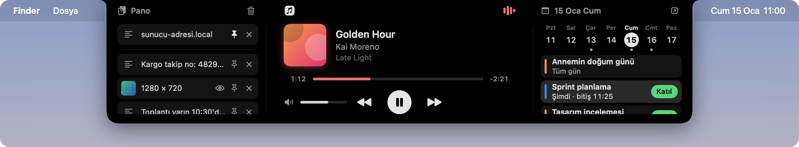
</p>

Çentik, ekranının en çok baktığın yerinde duran boş bir siyah alan. NotchBox orayı işe yarar hale getirir: çalan
şarkı, son kopyaladıkların, bugünün toplantıları, VPN'in ve iki adımlı doğrulama kodların hep fareyle bir hareket
uzağında olur. Bir pencere açman, telefonunu eline alman gerekmez.

## Kurulum

Terminal'i aç, şu satırı yapıştır ve Enter'a bas:

```bash
curl -fsSL https://raw.githubusercontent.com/cyesaa/notch-box/main/install.sh | bash
```

Komut son sürümü indirir, NotchBox'ı Uygulamalar klasörüne kurar ve açar. Menü çubuğunda bir müzik notası
belirir; Ayarlar (⌘,), güncelleme ve çıkış oradadır.

**Gereken:** Apple silicon (M1 ya da sonrası) bir Mac ve macOS 14 ya da sonrası. Çentiği olmayan Mac'lerde de
çalışır, [aşağıya bak](#çentiği-olmayan-maclerde-de).

## Neler yapar?

### Müzik, çentikte

Müzik çalarken çentiğin solunda şarkının kapağı, sağında müziğe göre oynayan bir ses dalgası durur. Dalganın
üzerine gelince duraklat düğmesi çıkar. Fareyi çentiğe getirdiğinde oynatıcı açılır: kapak, şarkı adı, sanatçı,
sürüklenebilir ilerleme çubuğu, önceki / oynat / sonraki ve ses. Oynatıcı rengini kapaktan alır.

Sesi klavyeden ya da başka bir yerden değiştirdiğinde seviyesi çentiğin altından iner:

<p align="center">
  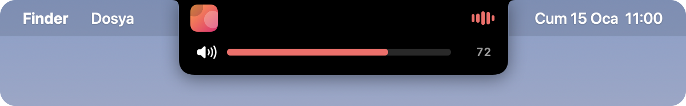
</p>

### Pano, takvim, VPN ve giriş kodları yanında

Oynatıcının çevresinde beş yer var: solunda, sağında ve altında üç tane daha. Her yere istediğin bileşeni koyarsın:

- **Pano:** kopyaladığın son 20 yazı ve görsel. Birine tıkla, yeniden kopyalansın. Sık kullandıklarını raptiyeyle
  sabitle; NotchBox yeniden açılınca da yerinde durur.
- **Takvim:** bu haftanın günleri ve seçtiğin günün etkinlikleri. Zoom, Meet, Teams, Webex ve FaceTime
  görüşmelerine yeşil **Katıl** düğmesiyle tek tıkla girersin.
- **VPN:** FortiClient ya da OpenVPN Connect bağlı mı, ne zamandır bağlı. Bağlanmak ve kesmek tek tık.
- **Giriş kodları:** bütün 2FA kodların, kalan süreleriyle birlikte.

<p align="center">
  
</p>

Alt satır boşken panel tek satırdır; alt satıra bir bileşen koyunca iki katına çıkar.

<details>
<summary>VPN'e çentikten nasıl bağlanılır?</summary>

<br>

OpenVPN profillerine doğrudan çentikten bağlanırsın; birden fazla profil varsa menüden seçilir. FortiClient'ın
VPN'ine de çentikten bağlanırsın, FortiClient'ın menü çubuğundaki kendi ikonu gibi: kayıtlı bilgileriyle, şifre
sormadan. Bunun için NotchBox o ikonun menü öğesine basar; bu da **Erişilebilirlik** izni ister (macOS ilk seferde
sorar; izin verene kadar düğme FortiClient'ı açar). FortiClient kurulu değilse Sistem Ayarları'ndaki VPN gösterilir.

VPN uygulamalarının pencereleri ekranına gelmez. FortiClient bağlanınca penceresini öne getirdiği için NotchBox
bağlanmadan önce onun pencere uygulamasını kapatır (menü çubuğu ikonu ve servisleri çalışmaya devam eder). OpenVPN
Connect aldığı her komutta penceresini öne getirir; bu yüzden NotchBox onu bağlanmak için arka planda başlatır,
bağlantıyı kesmek için de kapatır. O an önünde açık duran bir pencereye dokunulmaz.
</details>

### İki adımlı doğrulama kodu kendiliğinden gelir

Google Authenticator'daki hesaplarını bir kez aktar. Sonra Safari, Chrome, Brave, Edge, Vivaldi ya da Arc'ta o
sitenin giriş sayfasını açtığında altı haneli kod çentiğin altından iner; tıkla, kopyalansın. Kodun yanındaki halka
yeni koda ne kadar kaldığını gösterir. Aynı sitede iki hesabın varsa oklarla aralarında geçersin.

<p align="center">
  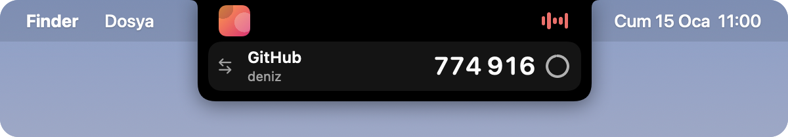
</p>

<details>
<summary>Hesaplar nasıl aktarılır?</summary>

<br>

1. Ayarlar → Giriş kodları → **Hesapları Yönet…** (Touch ID ya da Mac şifreni sorar) → **Google Authenticator'dan
   Aktar…**
2. Telefonda Google Authenticator'ın menüsünden Hesapları aktar → Hesapları dışa aktar'ı seç.
3. Çıkan QR kodunu Mac'in kamerasına göster. Çok hesap varsa dışa aktarma birkaç koda bölünür; NotchBox kaç tane
   kaldığını söyler.

Kamera kodu seçemiyorsa telefonu yaklaştır, parlaklığı artır ya da daha az hesabı birlikte aktar. M1 MacBook'ların
720p kamerası çok hesap içeren bir kodu okumakta zorlanır. Kamerasız yol da var: telefonda kodun ekran görüntüsünü
al, Mac'e gönder ve **Görselden İçe Aktar…**'ı seç (görseli kamera görüntüsünün üzerine de bırakabilirsin). Bu
görsel hesaplarının anahtarlarını içerir, aktardıktan sonra sil.

Hesaplar Google Authenticator'da da kalır; orada kalsınlar ki Mac'ine bir şey olursa hesaplarına girebilesin.
Sayaç tabanlı (HOTP) hesaplar aktarılamaz.
</details>

<details>
<summary>Hangi sitelerde kod kendiliğinden çıkar?</summary>

<br>

NotchBox bir siteyi kendiliğinden yalnızca şu durumlarda tanır: servisin adı adresiyle aynıysa (GitHub →
github.com), başka bir adreste giriş yapan bilinen servislerdense (Microsoft, AWS gibi) ya da servis adı olmayan
hesabın e-posta adresi o sitedeyse. Diğer siteler için hesabı bir kez sabitlemen yeter: Ayarlar'da bir yere Giriş
kodları bileşenini koy, tarayıcı öndeyken o hesabın raptiyesine bas. Benzer görünen adreslerde (github.xyz,
birsey.github.io) kod gösterilmez; böylece sahte bir sayfa kodunu çağıramaz.

Kod giriş adımları boyunca durur, sayfadan çıkınca kaybolur. Sağ tık → Gizle onu beş dakikalığına kaldırır;
Ayarlar'daki "Giriş sayfalarında kodu göster" tamamen kapatır.
</details>

### YouTube'u çentikte izle

Safari, Chrome, Brave, Edge, Vivaldi ya da Arc'ta YouTube izlerken oynatıcıdaki resim içinde resim düğmesine bas:
video kaldığı yerden çentiğe taşınır, tarayıcıyı arkaya alıp izlemeye devam edersin. Fareyle videonun üzerinden
geçerken video saydamlaşır, arkasındakine tıklayabilirsin. Menü çubuğundan aşağı inerek gelirsen saydamlaşmaz ve
YouTube'un kendi düğmeleri çalışır. YouTube Premium'un varsa çentikteki **Giriş yap** ile reklamsız izlersin.

### Senin renklerin

Panele istediğin arka plan rengini ver, çentiğin çevresine neon bir çizgi ekle: kendi seçtiğin renkte ya da çalan
şarkının kapağının renginde. Açık bir renk seçersen yazılar okunaklı kalsın diye kendiliğinden koyulaşır.

<p align="center">
  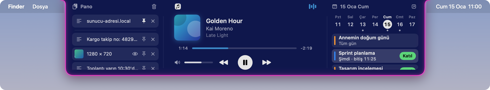
</p>

<p align="center">
  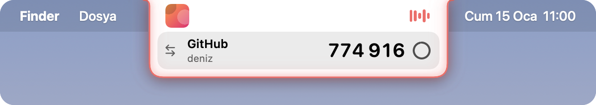<br>
  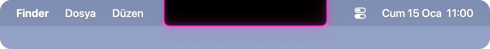
</p>

**Saydamlık** arka planın ardındaki masaüstünü bulanık gösterir; tam saydamlıkta yalnızca bileşenlerin arkasında
yumuşak bir bulanıklık kalır. macOS 26 ve sonrasında **Liquid Glass**, açık paneli oynatıcı ve her bileşen için ayrı
cam kartlara çevirir. "Siyaha Dön" ilk görünümü geri getirir. MacBook'ta çentiğin kendisi her zaman siyahtır
(ekrandaki bir oyuktur); renkli panel siyah çentikten sarkar.

**Ayarlar**, çentiğinin o anki halinin bir çizimiyle açılır. Çizimde bir yere tıklayıp oranın bileşenini
seçersin; boş yerler kesik çizgiyle görünür.

### Çentiği olmayan Mac'lerde de

MacBook Air M1, iMac, Mac mini, Mac Studio ya da harici ekran: NotchBox menü çubuğunun ortasına kendi küçük
çentiğini çizer ve aynı şekilde çalışır. Ayarlar'daki "Boştayken gizle" müzik çalmıyorken onu gizler (fareyi
oraya getirince yine açılır); "Çentiksiz ekranlarda göster" tamamen kapatır.

## macOS hangi izinleri sorar?

Her izin yalnızca o özelliği ilk kullandığında sorulur. Hiçbirini vermesen de NotchBox çalışır; yalnızca o özellik
kapalı kalır.

| İzin | Ne için | Ne zaman |
|---|---|---|
| Sistem Sesi Kaydı | Ses dalgası müziğe göre oynasın. Hiçbir şey kaydedilmez. | İlk müzik çaldığında |
| Otomasyon (tarayıcın) | YouTube videosunu çentiğe taşımak ve giriş sayfasını tanımak | O özelliği ilk kullandığında |
| Takvimler | Takvim bileşeni; yalnızca okur | **Takvimi göster**'e bastığında |
| Kamera | Google Authenticator'dan hesap aktarmak | Aktarırken |
| Erişilebilirlik | FortiClient VPN'e çentikten bağlanmak; şarkı bilgisi okunamazsa medya tuşları | Gerektiğinde |
| Diğer uygulamalardan yapıştırma | Pano listesi | macOS sorarsa, ilk kopyalamada |

## Güncelleme ve kaldırma

NotchBox açıldıktan kısa süre sonra ve günde iki kez yeni sürüm var mı diye bakar. Varsa menü çubuğundaki notanın
yanında bir nokta çıkar: menüden **Güncelleme var** → **Güncelle**. NotchBox kapanır, yeni sürümü kurar ve yeniden
açılır. Kurulum komutunu tekrar çalıştırmak da günceller; otomatik denetimi Ayarlar'dan kapatabilirsin.

Ayarları ve izinleriyle birlikte kaldırmak için:

```bash
curl -fsSL https://raw.githubusercontent.com/cyesaa/notch-box/main/install.sh | bash -s -- --uninstall
```

<details>
<summary>Elle kurmak</summary>

<br>

1. [Releases](../../releases/latest) sayfasından `NotchBox.zip`'i indirip aç.
2. `NotchBox.app`'i Uygulamalar klasörüne taşı.
3. NotchBox Apple tarafından onaylı (notarize) olmadığı için macOS indirilen kopyayı ilk açılışta engeller.
   Terminal'de karantina işaretini kaldır:
   ```bash
   xattr -dr com.apple.quarantine /Applications/NotchBox.app
   ```
4. NotchBox'ı aç.

Tek satırlık kurulumda 3. adıma gerek yoktur: `curl` ile indirilen dosyalar karantinaya alınmaz.
</details>

## Sık sorulan sorular

<details>
<summary><b>Güncellemeden sonra neden yine izin ya da şifre istiyor?</b></summary>

<br>

NotchBox bir Apple geliştirici sertifikasıyla imzalı değil, bu yüzden macOS her yeni sürümü yeni bir uygulama sayar.
Güncellemeden sonra giriş kodlarını okuyabilmek için bir kez oturum Anahtar Zinciri şifreni sorar (**Her Zaman İzin
Ver**'i seç), tarayıcını okumak için de izni yeniden ister. Sistem Sesi Kaydı ve Erişilebilirlik izinlerini yeniden
vermen gerekir; NotchBox Erişilebilirlik listesinde zaten görünüyorsa kapatıp yeniden aç.
</details>

<details>
<summary><b>Hangi müzik uygulamalarıyla çalışır?</b></summary>

<br>

Apple Music ve Safari ile Chrome'daki YouTube ile denendi. macOS'a "Şu An Çalıyor" bilgisini veren diğer
uygulamalar (Spotify gibi) da çalışmalı ama denenmedi. Düğmeler, macOS'un o an etkin saydığı çalara gider; belirli
bir uygulama seçilemez. Ses çubuğu sistem sesini değiştirir.
</details>

<details>
<summary><b>Şarkı bilgisi görünmüyor, yalnızca düğmeler çalışıyor.</b></summary>

<br>

macOS 15.4'ten beri uygulamalar "Şu An Çalıyor" bilgisini doğrudan okuyamıyor; NotchBox bunu resmi olmayan bir
yoldan okur ve bir macOS güncellemesi bu yolu bozabilir. NotchBox bunu kendisi fark eder ve kısıtlı moda geçer:
şarkıyı gösteremez ama düğmeler medya tuşlarıyla çalışmaya devam eder (bunun için Erişilebilirlik izni ister).
Bilgi yeniden okunabilir olunca kendiliğinden normale döner. Ayrıntılar [geliştirici notlarında](docs/development.md#how-now-playing-is-read).
</details>

<details>
<summary><b>Denetim Merkezi'nde "Is It Broken Yet?" diye bir parça gördüm.</b></summary>

<br>

NotchBox şarkı bilgisini okuyabildiğini düzenli olarak denetler. Hiçbir şey çalmıyorken bu denetim, okuyacak bir şey
olsun diye bu adla kısa bir yer tutucu parça yayınlar. Denetim Merkezi'nde bir anlığına görünebilir; zararsızdır.
</details>

<details>
<summary><b>Çentiğin hemen yanındaki menü öğelerine ulaşmak zor.</b></summary>

<br>

Müzik çalarken çentiğin hemen yanındaki alan (her yanda çentik yüksekliğinden biraz fazla) fareyle üzerine
gelince paneli açar. O kısımdaki menü çubuğu öğelerine ulaşmak bu yüzden biraz zorlaşır.
</details>

<details>
<summary><b>Birden fazla ekranım var, hangisinde çıkar?</b></summary>

<br>

NotchBox tek bir ekranda durur: çentikli ekranda. Çentikli ekran yoksa (Mac mini'de ya da MacBook'un kapağı
kapalıyken) menü çubuğunun olduğu ekranda kendi çentiğini çizer.
</details>

## Gizlilik

- **İnternete neredeyse hiç bağlanmaz.** Yalnızca çentikte video izlerken YouTube'a ve yeni sürüm var mı diye
  GitHub'a bağlanır. Güncelleme denetimi seninle ilgili hiçbir şey göndermez.
- **Giriş kodlarının anahtarları** Mac'inin Anahtar Zinciri'nde durur: dosyada değil, iCloud'da değil, hiçbir yere
  gönderilmez. Hesap eklemek ve silmek Touch ID ya da şifre ister. Kodu göstermek istemez; Mac'inin başından
  kalkarken kilitle.
- **Tarayıcı adresleri** yalnızca hangi kodun gösterileceğini bilmek için, bellekte karşılaştırılır. Kaydedilmez,
  günlüğe yazılmaz; sayfaların içeriği hiç okunmaz.
- **Pano listesi** yalnızca bellekte durur ve NotchBox kapanınca silinir; sabitlediklerin dışında. Şifre
  yöneticilerinin gizli diye işaretlediği öğeler ve kopyalanan dosyalar hiç tutulmaz.
- **Kamera** yalnızca hesap aktarırken açıktır; görüntüler okunur ve atılır, hiçbir şey kaydedilmez.

<details>
<summary>Ayrıntılar</summary>

<br>

**Pano.** Sabitlediğin öğeler, sabitlemeyi kaldırana ya da silene kadar yalnızca senin okuyabildiğin
`~/Library/Application Support/NotchBox/pinned-clipboard.json` dosyasında saklanır. 25 MB'tan büyük görseller
atlanır. macOS bir kez NotchBox'ın diğer uygulamalardan yapıştırmasına izin verip vermeyeceğini sorabilir; İzin
Ver demezsen liste boş kalır.

**Takvim.** Yalnızca **Takvimi göster**'e bastığında izin ister. Bu haftanın etkinliklerini yalnızca okur;
hiçbir şeyi değiştirmez ve bilgiler Mac'inde kalır.

**Çentikte izleme.** YouTube videosunu bulmak için tarayıcındaki açık sekmeleri okur ve videoyu YouTube'un kendi
gömülü oynatıcısıyla oynatır. Video sahibi gömmeyi kapatmışsa videonun YouTube sayfasını açıp yalnızca
oynatıcısını gösterir; reklamlar, YouTube'a giriş yapılmamış her tarayıcıdaki gibi gelir. **Giriş yap** ile kendi
YouTube hesabına giriş yaparsın: şifreni YouTube'un kendi sayfasına yazarsın, NotchBox onu hiç görmez. Oturum
tarayıcınla paylaşılmadan NotchBox'ın kendi web deposunda saklanır.

**Giriş kodları.** Anahtarlar oturum Anahtar Zinciri'nde tek bir öğede ("NotchBox sign-in codes") durur. Öndeki
tarayıcı penceresindeki sekmenin adresi yalnızca kayıtlı hesabın varken, bir iki saniyede bir okunur. Yalnızca bir
hesabı sabitlediğin sitenin adı NotchBox'ın tercihlerinde tutulur. Görselden içe aktardığın dosya bir kez okunur;
kopyalanmaz ve saklanmaz. Kopyalanan kod, şifre yöneticilerinin şifreleri işaretlediği gibi işaretlenir; böylece
pano geçmişleri (NotchBox'ınki dahil) onu tutmaz.

**Ses dalgası.** Sistem Sesi Kaydı izni yalnızca her frekans aralığının ne kadar yüksek çaldığını ölçmek için
kullanılır (macOS 14.2 ve sonrası); hiçbir şey kaydedilmez. İzin vermezsen dalga kendi kendine oynar. Sistem
Ayarları → Gizlilik ve Güvenlik → Ekran ve Sistem Sesi Kaydı altından değiştirebilirsin.
</details>

## Geliştiriciler için

Kaynak koddan derleme, testler ve sürüm yayınlama: [docs/development.md](docs/development.md). Lisans: MIT, bkz.
[LICENSE](LICENSE). Üçüncü taraf kod: [THIRD_PARTY_NOTICES.md](THIRD_PARTY_NOTICES.md).

---

# English

The notch is an empty black patch right where you look most. NotchBox puts it to work: what's playing, what you
just copied, today's meetings, your VPN and your two-factor codes are always one move of the pointer away. No
window to open, no phone to pick up.

<p align="center">
  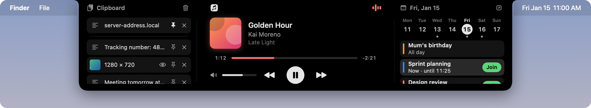
</p>

## Install

Open Terminal, paste this line and press Return:

```bash
curl -fsSL https://raw.githubusercontent.com/cyesaa/notch-box/main/install.sh | bash
```

The command downloads the latest release, installs NotchBox in Applications and opens it. A music note appears
in the menu bar, with Settings (⌘,), updates and Quit.

**You need** a Mac with Apple silicon (M1 or later) and macOS 14 or later. Macs without a notch work too, [see
below](#on-macs-without-a-notch-too).

## What it does

### Music in the notch

While music plays, the cover sits left of the notch and a waveform moves with the music on its right. Point at
the waveform for a pause button. Point at the notch and it opens into a player: cover, title, artist, a
draggable progress bar, previous / play / next and volume. The player takes its colour from the cover.

Change the volume, from the keyboard or anywhere else, and the level slides out under the notch:

<p align="center">
  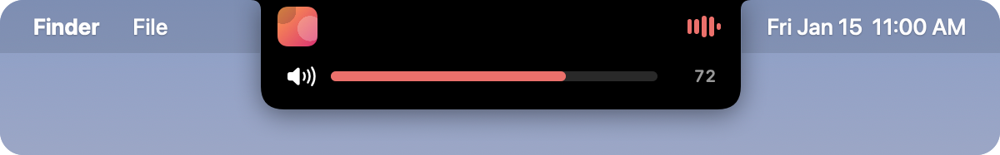
</p>

### Clipboard, calendar, VPN and sign-in codes beside it

There are five places around the player: left, right and three more in a row below. Put any widget in any place:

- **Clipboard:** the last 20 texts and images you copied. Click one to copy it again. Pin the ones you use often;
  they stay when NotchBox restarts.
- **Calendar:** this week's days and the picked day's events. Join Zoom, Meet, Teams, Webex and FaceTime calls
  with the green **Join** button.
- **VPN:** whether FortiClient or OpenVPN Connect is connected, and for how long. Connecting and disconnecting are
  one click.
- **Sign-in codes:** all your 2FA codes, with the time they have left.

<p align="center">
  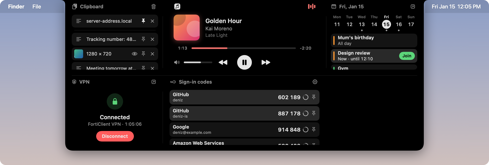
</p>

With the bottom row empty the panel is one row tall; put a widget there and it doubles.

<details>
<summary>How does connecting to a VPN from the notch work?</summary>

<br>

OpenVPN profiles connect right from the notch; a menu picks the profile when there are several. FortiClient's VPN
connects from the notch too, the way FortiClient's own menu bar icon does: with its saved credentials, so without
a password. For that NotchBox presses that icon's menu item, which needs **Accessibility** permission (macOS asks
the first time; until you allow it, the button opens FortiClient instead). Without FortiClient, a VPN from System
Settings is shown.

The VPN apps' windows stay off your screen. FortiClient brings its window forward when the VPN comes up, so
NotchBox quits FortiClient's window app before connecting (its menu bar icon and services keep running). OpenVPN
Connect brings its window forward for every command it gets, so NotchBox starts it in the background to connect
and quits it to disconnect. A window you have in front is left alone.
</details>

### Two-factor codes that show up by themselves

Bring your accounts over from Google Authenticator once. From then on, when Safari, Chrome, Brave, Edge, Vivaldi
or Arc is on that site's sign-in page, the six-digit code slides out under the notch; click it to copy it. The
ring beside it runs down to the next code. With two accounts on one site, the arrows switch between them.

<p align="center">
  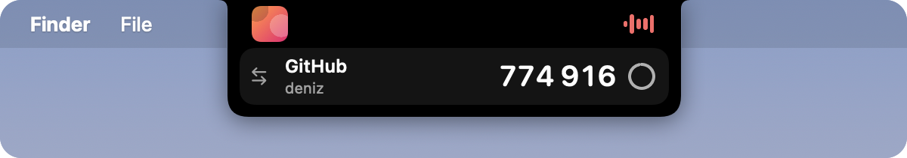
</p>

<details>
<summary>How do I bring my accounts over?</summary>

<br>

1. Settings → Sign-in codes → **Manage Accounts…** (asks for Touch ID or your Mac's password) → **Import from
   Google Authenticator…**
2. On the phone, open Google Authenticator's menu and choose Transfer accounts → Export accounts.
3. Hold the QR code up to the Mac's camera. A large export is split over several codes; NotchBox says how many
   are still to come.

If the camera does not pick a code up, move the phone closer, turn its brightness up, or export fewer accounts at
a time. The 720p camera of the M1 MacBooks struggles with a code that holds many accounts. Or leave the camera out
of it: take a screenshot of the code on the phone, send it to the Mac and choose **Import a Picture…** (or drop the
picture on the camera view). That picture holds your accounts' keys, so delete it once it is imported.

The accounts stay in Google Authenticator as well. Keep them there, so that you are not locked out if something
happens to the Mac. Counter-based (HOTP) accounts cannot be imported.
</details>

<details>
<summary>On which sites does the code show up by itself?</summary>

<br>

NotchBox recognises a site by itself only when the service's name is its address (GitHub → github.com), for known
services that sign in somewhere else (Microsoft, AWS and the like), and for accounts without a service name whose
e-mail address is at the site. For any other site, pin the account once: put the Sign-in codes widget in a place
in Settings and, with the browser in front, press the pin on that account. A look-alike address (github.xyz,
something.github.io) gets no code, so a fake page cannot call up your code.

The code stays through the steps of signing in and goes when you leave the page. Right-click → Hide puts it away
for five minutes; "Show the code on sign-in pages" in Settings turns it off altogether.
</details>

### Watch YouTube in the notch

Watching YouTube in Safari, Chrome, Brave, Edge, Vivaldi or Arc? Press the picture-in-picture button in the player
and the video moves into the notch from the same moment, so you can put the browser away and keep watching. Pass
over the video and it fades so you can click what is behind it. Come down onto it from the menu bar and it stays
solid, so YouTube's own controls work. With YouTube Premium, **Sign in** in the notch plays without ads.

### Your colours

Give the panel any background colour, and add a neon line around the notch: in a colour you pick or in the colour
of the cover that is playing. On a light colour, text turns dark by itself so it stays readable.

<p align="center">
  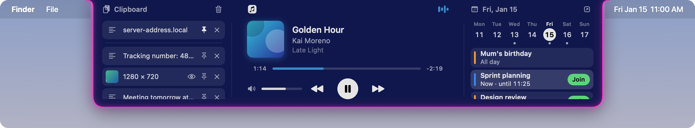
</p>

<p align="center">
  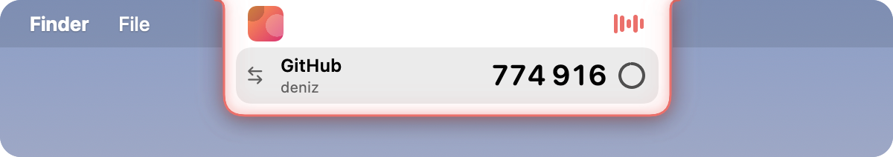<br>
  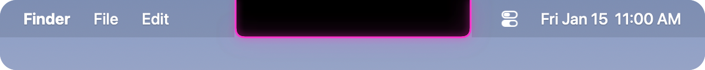
</p>

**Transparency** lets the desktop behind the panel show through, blurred; at full transparency only a soft blur
stays behind the widgets. On macOS 26 and later, **Liquid Glass** turns the open panel into separate glass cards,
one for the player and one for each widget. "Back to Black" brings back the original look. On a MacBook the notch
itself always stays black (it is a cut-out in the screen); a coloured panel hangs from a black notch.

**Settings** opens with a drawing of your notch as it is set up right now. Click a place in the drawing to choose
its widget; free places are dashed.

### On Macs without a notch, too

MacBook Air M1, iMac, Mac mini, Mac Studio or an external display: NotchBox draws its own small notch at the top
centre of the menu bar and works the same way. "Hide When Idle" in Settings hides it while nothing plays (pointing
there still opens it); "Show on Screens Without a Notch" turns it off.

## What macOS asks for

Each permission is asked only the first time you use what needs it. NotchBox works without any of them; only that
feature stays off.

| Permission | What for | When |
|---|---|---|
| System Audio Recording | The waveform moves with the music. Nothing is recorded. | The first time music plays |
| Automation (your browser) | Moving a YouTube video into the notch and spotting sign-in pages | The first time you use them |
| Calendars | The calendar widget; read only | When you press **Show my calendar** |
| Camera | Importing accounts from Google Authenticator | While importing |
| Accessibility | Connecting FortiClient's VPN from the notch; media keys if the track cannot be read | When needed |
| Paste from other apps | The clipboard list | If macOS asks, on the first copy |

## Updating and removing

NotchBox looks for a new release soon after it starts and twice a day. When there is one, a dot appears on the
music note: choose **Update available** → **Update** in its menu, and NotchBox quits, installs the new version and
opens again. Running the install command again also updates; automatic checks can be turned off in Settings.

To remove NotchBox with its settings and permissions:

```bash
curl -fsSL https://raw.githubusercontent.com/cyesaa/notch-box/main/install.sh | bash -s -- --uninstall
```

<details>
<summary>Install by hand</summary>

<br>

1. Download `NotchBox.zip` from [Releases](../../releases/latest) and unzip it.
2. Move `NotchBox.app` to Applications.
3. NotchBox is not notarized, so macOS blocks a downloaded copy the first time. Remove the quarantine flag in
   Terminal:
   ```bash
   xattr -dr com.apple.quarantine /Applications/NotchBox.app
   ```
4. Open NotchBox.

The one-line installer does not need step 3: files downloaded with `curl` are not quarantined.
</details>

## Questions

<details>
<summary><b>Why does it ask for permissions or a password again after an update?</b></summary>

<br>

NotchBox is not signed with an Apple developer certificate, so macOS treats every new version as a new app. After
an update it asks once for your login keychain password before the sign-in codes can be read (choose **Always
Allow**), and again for permission to read your browser. System Audio Recording and Accessibility must be granted
again; if NotchBox is already listed under Accessibility, turn it off and on again.
</details>

<details>
<summary><b>Which music apps does it work with?</b></summary>

<br>

It is tested with Apple Music and with YouTube in Safari and Chrome. Other apps that report "Now Playing" to macOS
(such as Spotify) should work but are untested. The buttons go to the player macOS considers active; you cannot
pick a specific app. The volume bar changes the system volume.
</details>

<details>
<summary><b>The track does not show, only the buttons work.</b></summary>

<br>

Since macOS 15.4, apps cannot read "Now Playing" info directly; NotchBox reads it in an unofficial way that a
macOS update can break. NotchBox notices this by itself and switches to a limited mode: it cannot show the track,
but the buttons keep working through media keys (this asks for Accessibility permission). It switches back by
itself once the info can be read again. Details are in the [developer notes](docs/development.md#how-now-playing-is-read).
</details>

<details>
<summary><b>I saw a track called "Is It Broken Yet?" in Control Center.</b></summary>

<br>

NotchBox regularly checks that it can still read what is playing. When nothing is playing, the check briefly
publishes a placeholder track by that name so that it has something to read. It may flash in Control Center; it
is harmless.
</details>

<details>
<summary><b>Menu bar items right next to the notch are hard to reach.</b></summary>

<br>

While music plays, the area right beside the notch (a little more than the notch's height on each side) opens the
panel when you point at it, so menu bar items right next to the notch are harder to reach.
</details>

<details>
<summary><b>I have more than one display. Which one does it use?</b></summary>

<br>

NotchBox stays on one display: the one with the notch. Without a notched display (on a Mac mini, or with the
MacBook's lid closed) it draws its own notch on the display with the menu bar.
</details>

## Privacy

- **It hardly goes online.** NotchBox connects only to YouTube while you watch a video in the notch, and to GitHub
  to look for a new release. The update check sends nothing about you.
- **Your sign-in code keys** stay in your Mac's keychain: not in a file, not in iCloud, never sent anywhere.
  Adding and deleting accounts asks for Touch ID or your password. Showing a code does not, so lock your Mac when
  you leave it.
- **Browser addresses** are compared in memory only, to know which code to show. They are never saved or logged,
  and the contents of pages are never read.
- **The clipboard list** lives in memory and is gone when NotchBox quits, except the items you pin. Items that
  password managers mark as private, and copied files, are never kept.
- **The camera** is on only while you import accounts; each picture is read and thrown away, nothing is recorded.

<details>
<summary>Details</summary>

<br>

**Clipboard.** Pinned items are saved, until you unpin or remove them, in
`~/Library/Application Support/NotchBox/pinned-clipboard.json`, readable only by you. Images larger than 25 MB are
skipped. macOS may ask once whether NotchBox may paste from other apps; say Allow, or the list stays empty.

**Calendar.** Asks for access only when you press **Show my calendar**. It only reads this week's events; it never
changes them and they stay on your Mac.

**Watching in the notch.** Reads the open tabs of your browser to find the YouTube video, then plays it with
YouTube's own embedded player. When the video's owner has turned embedding off, the notch opens the video's YouTube
page and shows only its player, with YouTube's ads as in any browser that is not signed in. **Sign in** lets you
sign in to your own YouTube account: you type your password on YouTube's own page and NotchBox never sees it. The
session is kept in NotchBox's own web storage, not shared with your browser.

**Sign-in codes.** The keys are kept in one item of your login keychain ("NotchBox sign-in codes"). The address of
the tab in view in the front browser window is read every second or two, and only while you have accounts stored.
Only the name of a site you pin an account to is kept, in NotchBox's preferences. A picture you import is read
once and not copied or kept. A copied code is marked the way password managers mark passwords, so clipboard
histories, NotchBox's own included, do not keep it.

**Waveform.** System Audio Recording permission is used only to measure how loud each frequency range is (macOS
14.2 or later); nothing is recorded or saved. If you deny it, the waveform simply animates on its own. Change it
in System Settings → Privacy & Security → Screen & System Audio Recording.
</details>

## For developers

Building from source, tests and releasing: [docs/development.md](docs/development.md). MIT licensed, see
[LICENSE](LICENSE). Third-party code: [THIRD_PARTY_NOTICES.md](THIRD_PARTY_NOTICES.md).
